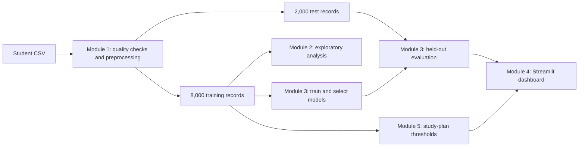

# Student Performance Prediction System

**Machine learning capstone by Sujay Jagtap**

**Live dashboard:** [Open the Streamlit app](https://studentperformancepredictionsystem-gci2b8gat5sfpnoxpn8zyp.streamlit.app/)

This project estimates a student's final exam score, translates that score into a **Low**, **Average**, or **High** performance level, and presents the result in an interactive Streamlit dashboard. A separate rule-based study plan suggests areas to review. The dashboard offers two prediction modes: one using 11 standard inputs and another adding four earlier mock marks.

> **Reading the results:** The accuracy figures below come from this project's 2,000-record test split. They are not a guarantee for a new student or school. The optional model assumes the four subject marks were recorded before the final exam; the CSV does not independently verify their timing.

## At a glance

| Item | Details |
| --- | --- |
| Dataset | 10,000 student records, 23 columns |
| Target | `final_exam_score`, out of 100 |
| Split | 8,000 training records and 2,000 test records (80/20) |
| Default model | Polynomial Ridge regression using 11 inputs; **80.60%** test level accuracy |
| Earlier-marks model | Separately trained Polynomial Ridge using 15 inputs; **93.95%** test level accuracy |
| Interface | Four-page Streamlit dashboard with Plotly charts |
| Study plan | Transparent rules using training-cohort thresholds and optional mock marks |

## What the system does

1. **Explore the cohort.** View final-score distributions, performance levels, study-time groups, subject averages, and sample held-out predictions.
2. **Compare students.** Select up to four recorded IDs and compare final scores, study and attendance fields, and subject profiles.
3. **Predict a new result.** Enter pre-exam information and choose whether four earlier mock marks should enter the prediction. The app shows a predicted score and a level derived from that same score.
4. **Inspect model performance.** Switch between modes to see the corresponding test metrics, actual-versus-predicted chart, confusion matrix, and downloadable predictions.
5. **Review a study plan.** See up to four rule-based suggestions after a prediction. With four mock marks, the plan can highlight a comparatively weak subject.

The sidebar model choice updates **Overview** and **Model Insights**. The same choice appears on **Predict Performance**. Cohort charts still describe the same students in both modes; model evaluation cards and test predictions change with the selected model.

## Project workflow



### Module 1 — Data preprocessing

The pipeline reads the supplied CSV, checks duplicate records and IDs, missing values, and numeric ranges, then creates a reproducible **score-decile-stratified 80/20 split** with random seed 42. This copy has **no missing cells** and **no exact duplicate rows**. Numeric inputs use median imputation and standard scaling; categorical inputs use most-frequent imputation and one-hot encoding. Preprocessing is fitted on training data only, so test records do not influence those fitted steps. Cleaned data, a split manifest, a saved preprocessor, and a quality report are in [`module1/`](module1/).

### Module 2 — Exploratory analysis

The analysis uses the **training split only**. It examines the final-score distribution, study time, attendance, previous GPA, subject marks, and correlations. The training-cohort mean final score is **49.67/100**. Average scores are **39.76** for students reporting under two study hours per day and **64.34** for those reporting five or more. These are group descriptions, not estimates of what changing study time would cause. Charts and the full report are in [`module2/`](module2/).


### Module 3 — Prediction and evaluation

The **default model** predicts `final_exam_score` from these 11 fields:

| Numeric inputs | Categorical inputs |
| --- | --- |
| Study hours per day, attendance rate, sleep hours, social-media hours, assignment completion rate, participation score, online courses completed, previous GPA | Internet access, study environment, tutoring |

The optional **earlier-marks model** adds `math_score`, `reading_score`, `writing_score`, and `science_score`, for **15 inputs total**. It is separately trained; selecting it loads its saved artifact rather than retraining. The four subject columns are treated as earlier mock marks based on the project owner's confirmation. Original dataset documentation has not independently established their timing or whether they contribute to the final score.

The project compared a dummy mean predictor, linear Ridge, Polynomial Ridge, decision tree, and random forest regressors using **five-fold cross-validation within the 8,000-row training pool**. Each fold refits preprocessing. The selected score model is **degree-two Polynomial Ridge (alpha 20)**, chosen by validation accuracy of levels derived from predicted scores, with macro F1 as the tie-breaker. A direct random-forest level classifier was trained for comparison, but the dashboard derives its displayed level from its displayed score so the two agree.

Training-only five-fold level accuracy was **80.7%** without mock marks and **92.64%** with them. The table below reports the separate test-split results.

| Performance level | Final-score rule |
| --- | --- |
| Low | Below 50 |
| Average | 50 through 65, inclusive |
| High | Above 65 |

**Held-out evaluation on the same 2,000 test records:**

| Metric | Without mock marks (11 inputs) | With earlier mock marks (15 inputs) |
| --- | ---: | ---: |
| Score MAE, points ↓ | 4.15 | 1.52 |
| Score RMSE, points ↓ | 5.21 | 1.91 |
| Score R² ↑ | 0.818 | 0.976 |
| Level accuracy ↑ | 80.60% | 93.95% |
| Balanced accuracy ↑ | 76.43% | 93.13% |
| Macro F1 ↑ | 0.776 | 0.934 |

**MAE and RMSE are exam-score points, not percentages.** Balanced accuracy averages recall across levels; macro F1 gives each level equal weight. These measures matter because the three groups are uneven. The earlier-marks mode improves test level accuracy by **13.35 percentage points** on this split. Detailed reports, comparison tables, and model artifacts are in [`module3/`](module3/).

### Module 4 — Dashboard

The [Streamlit app](module4/app.py) has four pages:

| Page | Main content |
| --- | --- |
| **Overview** | Training-cohort KPIs and charts, plus metrics and examples from the selected model's test results |
| **Student Explorer** | Comparisons of recorded students, including actual scores and four subject marks |
| **Predict Performance** | Input form, earlier-marks choice, predicted score and level, and study plan |
| **Model Insights** | Held-out MAE, R², accuracy, macro F1, actual-versus-predicted plot, confusion matrix, and test-prediction table |

Overview filters affect training-cohort summaries. They do **not** recalculate the fixed test metrics. The interface uses a light blue and teal card layout, with Plotly for interactive charts.

### Module 5 — Study recommendations

The study plan is **rule based**, separate from model training. Its reference cutoffs come from quartiles of the training cohort. Rules can flag study routine, attendance, assignment completion, participation, focus time, study environment, or foundational practice. A subject-focus card appears when all four mock marks are provided and the lowest is at least **8 points below the mean of the other three**. The app shows at most four prioritized suggestions. These are prompts for a student and teacher to discuss; they do not predict a specific score gain. See the [recommendation design](module5/reports/recommendation_design.md).

## Run locally

Use **Python 3.12** and run these commands from the repository root:

```bash
python3 -m venv .venv
source .venv/bin/activate
python -m pip install -r module4/requirements.txt
python -m streamlit run module4/app.py
```

On Windows, activate with `.venv\Scripts\activate` instead. Open the local address Streamlit prints, usually `http://localhost:8501`. The repository includes the CSV, saved models, preprocessing artifacts, test predictions, and recommendation thresholds needed to view the dashboard; **retraining is not required** just to run it. No API keys are needed.

To reproduce the pipeline from the source CSV, install the relevant module requirements and run the scripts in order:

```bash
python -m pip install -r module1/requirements.txt -r module2/requirements.txt -r module3/requirements.txt -r module5/requirements.txt
python module1/preprocess.py
python module2/eda.py
python module3/train_models.py
python module3/train_mock_marks_model.py
python module5/build_rules.py
```

The training scripts use the saved split so both prediction modes are evaluated on the same students. Module-specific instructions and generated reports are in each module's README.

## Repository layout

```text
.
├── module1/   # Raw and processed data, preprocessing, quality report
├── module2/   # Exploratory analysis, charts, summary tables
├── module3/   # Training, inference, models, evaluation reports
├── module4/   # Streamlit dashboard and dependencies
├── module5/   # Recommendation rules, thresholds, examples
├── .streamlit/ # Dashboard theme
└── README.md
```

For Streamlit Community Cloud, set the repository branch to `main`, the app entry point to **`module4/app.py`**, and Python to **3.12**. The app's dependency file is [`module4/requirements.txt`](module4/requirements.txt).

## Data and interpretation limits

- The dataset was supplied for this project. Its original publisher, collection method, and synthetic-data status have **not been verified**. Confirm those details before presenting it as a real-world student dataset.
- The four subject columns are used as earlier mock marks only under the project owner's timing assumption. Their average is exceptionally correlated with the final score in this dataset, so the 93.95% result needs careful interpretation.
- The 2,000-row test split was revisited during project iterations. It is held out from model fitting, **not fresh external validation**. Performance on a different school or cohort may differ.
- `pass_fail`, `grade_category`, student ID, and demographic/background fields are excluded from prediction. Some source result labels conflict, so performance levels use the documented numeric cutoffs instead.
- The dataset has no dates or term identifier. Dashboard comparisons do not establish time trends or causal effects.
- This tool supports discussion and exploration. A teacher should review any individual prediction or study suggestion before it informs an academic decision.

## Tech stack

**Python · pandas · NumPy · scikit-learn · joblib · Streamlit · Plotly · Matplotlib · Seaborn**
