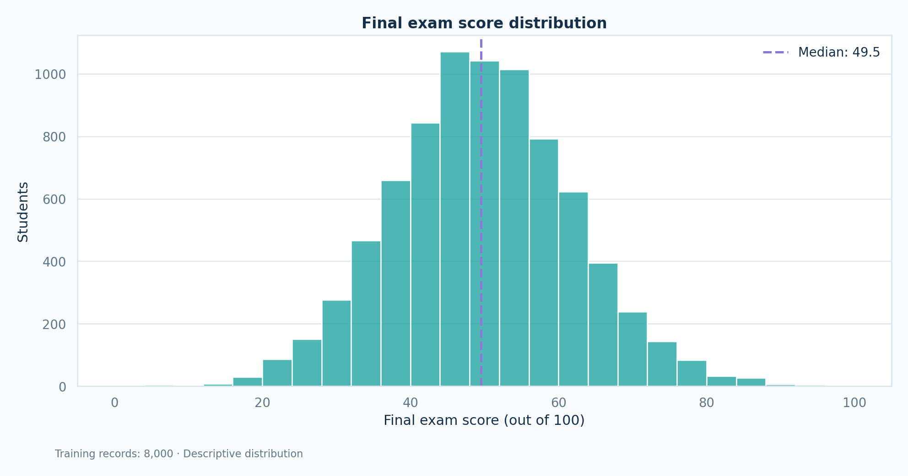
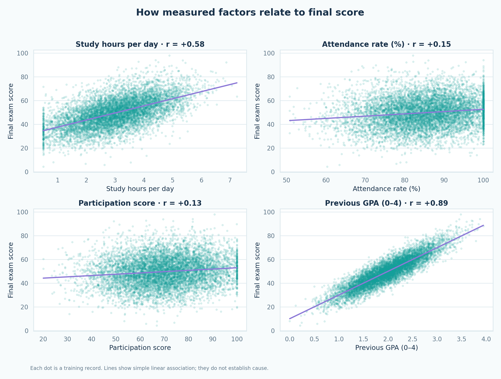
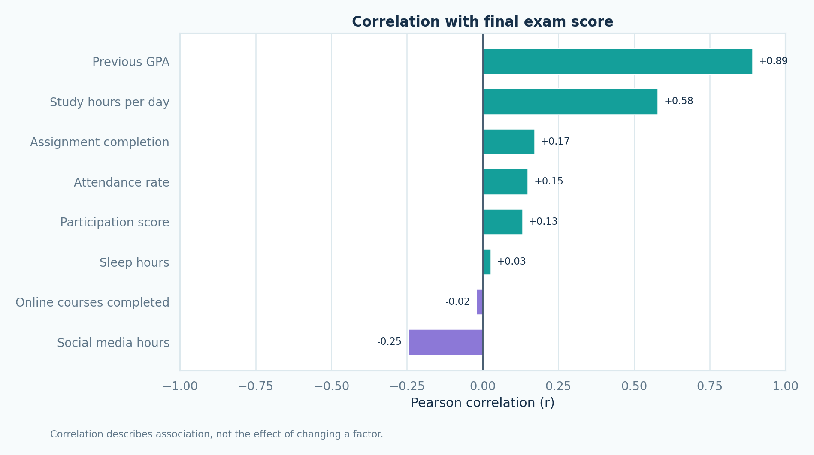
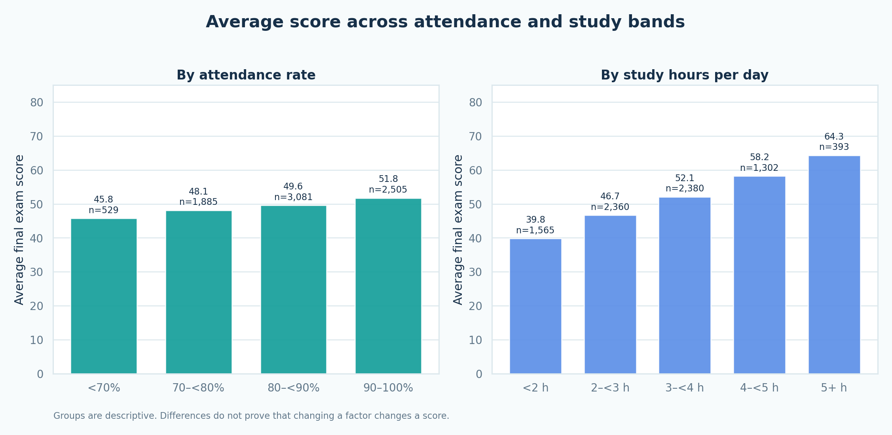
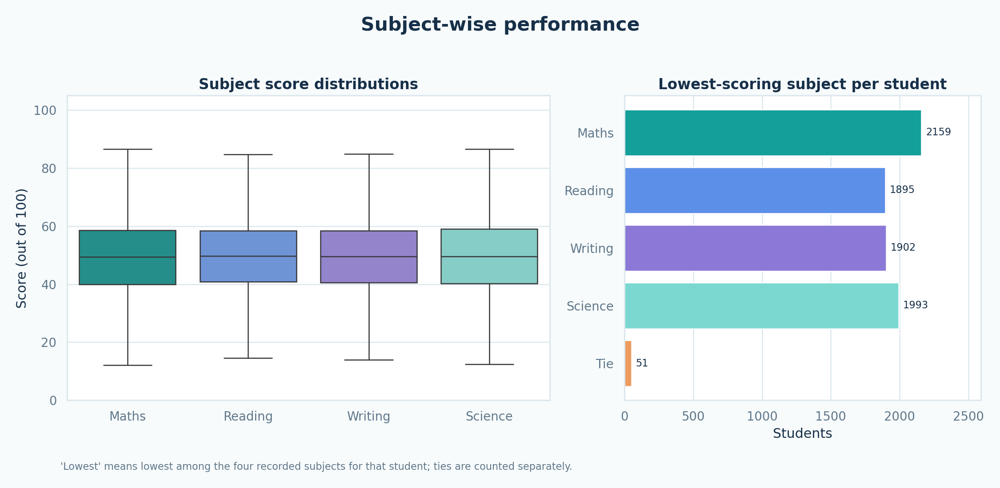

# Module 2 — Exploratory data analysis

## Data used

This report analyzes the **8,000 training records** selected in Module 1 from the **10,000 cleaned records**. The 2,000 test records remain reserved for later model evaluation. Scores and factors are displayed in their original units. The data's original collection method and whether records are synthetic have not been verified.

## Overview

- Final exam score: mean **49.67**, median **49.55**, standard deviation **12.13**, range **4.4–97.8** out of 100.
- Students with a final score of at least 50: **3,882 (48.5%)**. This uses the numeric score rather than the supplied `pass_fail` label.
- Supplied grade counts in the training split: A **7**, B **63**, C **729**, D **3,059**, F **4,142**. The top letter grades are rare.

## Relationships with final score

The table ranks the behavioral and previous-performance numeric fields by absolute Pearson correlation. Subject marks are analyzed separately below. A positive value means higher values tend to occur with higher final scores in this dataset; a negative value means the opposite. These are **associations, not causal effects**.

| Field | Pearson r | Spearman r |
| --- | --- | --- |
| Previous GPA | +0.891 | +0.882 |
| Study hours per day | +0.579 | +0.574 |
| Social media hours | -0.247 | -0.242 |
| Assignment completion | +0.171 | +0.163 |
| Attendance rate | +0.149 | +0.152 |
| Participation score | +0.132 | +0.135 |
| Sleep hours | +0.027 | +0.025 |
| Online courses completed | -0.021 | -0.018 |

Previous GPA and study hours have the strongest associations among the fields in this table. The four subject scores are shown separately because they are academic marks rather than behavioral factors. Their within-student mean correlates **0.986** with the final score. Module 3 excludes them from prediction because the CSV does not verify their timing or whether they contribute directly to the final score.

## Attendance and study bands

| Factor | Band | Average final score | Students |
| --- | --- | --- | --- |
| Attendance | <70% | 45.75 | 529 |
| Attendance | 70–<80% | 48.13 | 1,885 |
| Attendance | 80–<90% | 49.59 | 3,081 |
| Attendance | 90–100% | 51.76 | 2,505 |
| Study time | <2 h | 39.76 | 1,565 |
| Study time | 2–<3 h | 46.66 | 2,360 |
| Study time | 3–<4 h | 52.07 | 2,380 |
| Study time | 4–<5 h | 58.21 | 1,302 |
| Study time | 5+ h | 64.34 | 393 |

These are group averages, so differences may reflect other variables and should not be presented as the effect of changing attendance or study time.

## Subject-wise analysis

| Subject | Mean score | Median score |
| --- | --- | --- |
| Maths | 49.48 | 49.40 |
| Reading | 49.74 | 49.70 |
| Writing | 49.63 | 49.60 |
| Science | 49.82 | 49.60 |

Lowest-scoring subject within each student's four recorded scores:

| Subject | Students |
| --- | --- |
| Maths | 2,159 |
| Reading | 1,895 |
| Writing | 1,902 |
| Science | 1,993 |
| Tie | 51 |

There are **51** students with a tie for the lowest score. The dashboard can show a selected student's four subject scores and identify the lowest recorded one. That comparison does not establish the reason for the score.

## Implications for the next modules

1. Model development can use `final_exam_score` as the numeric target. Low/Average/High thresholds need to be defined and checked for class balance before training a classification model.
2. Keep `pass_fail` and `grade_category` out of predictor inputs; they describe the outcome. The source has 30 records marked both `Pass` and grade `F`, as documented in Module 1.
3. Keep subject scores in the dashboard for descriptive comparison, but exclude them from model inputs. Verify the original field definitions before considering them for prediction.
4. The CSV contains no dates or term identifiers. A chronological performance-trend chart would require additional data; grouped and subject comparisons are supported.
5. The original data source and any synthetic-data status should be verified and cited in the final project report.
